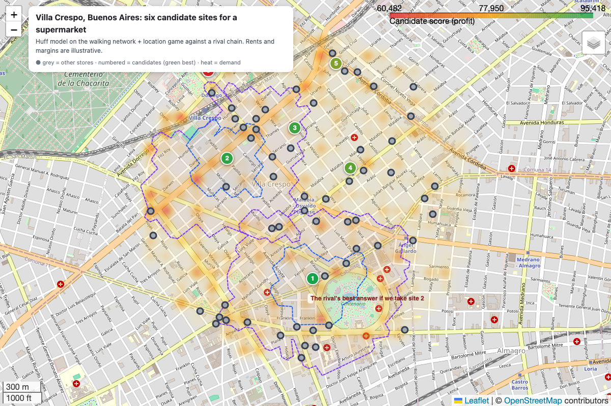
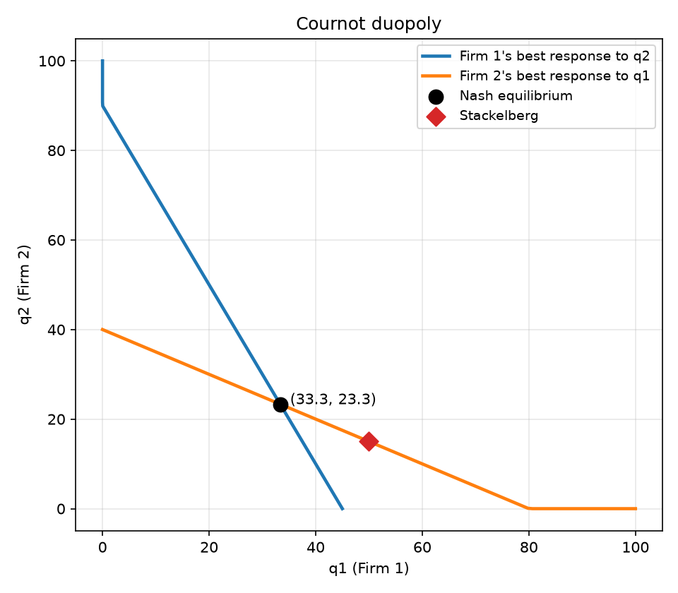
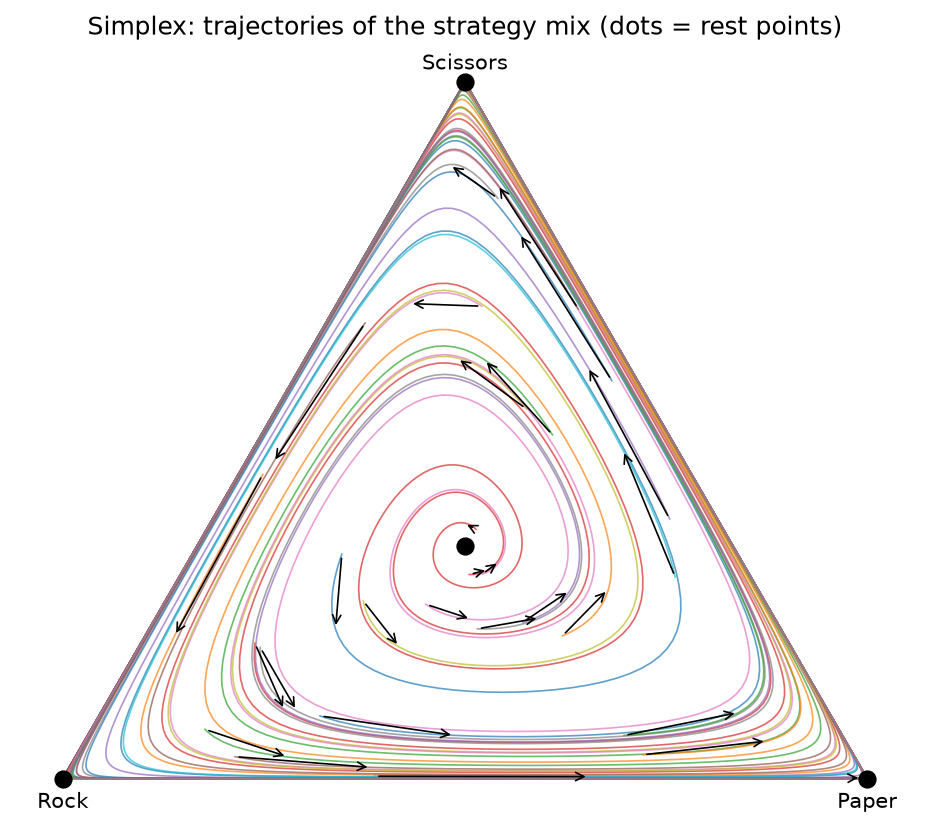

<p align="center"></p>

# io-gametheory

**An applied industrial-organization and game-theory analyst, packaged as an agent skill.**

Ask it where to open a store, how much to bid in a tender, what to ask for in a salary negotiation, whether a merger will raise prices, whether bids look rigged, or which strategy survives in a population. It frames the question, gets the data, writes the game down, solves it with verified code, attacks its own conclusion, and explains the result so a non-economist can follow it.

A language model already knows the theory. What it lacks is discipline. This skill supplies the discipline: a fixed seven-step method, 20 solvers that check their own answers, and a mandatory "game card" at the end.

## What it covers

| Module | Questions it answers | Tools |
|---|---|---|
| **Core solvers** | Any game: discrete or continuous strategies, simultaneous or sequential, pure or mixed equilibria | Nash (support enumeration, MILP), backward induction with non-credible threats, continuous best responses with symbolic comparative statics and grid cross-checks, mixed equilibria of discontinuous games |
| **Location** | Where to open, how much a site captures, cannibalization, what the rival will do about it | Competitors from OpenStreetMap and Overture Maps (worldwide), demand from census or population grids, walking/driving isochrones on the real street network, Huff gravity model, two-chain location game with lease exclusivity, interactive maps |
| **Hotelling** | Cluster or spread out? Product positioning, political platforms, quality tiers, how many stores fit | One verified engine for every variant: linear/quadratic costs, line or circle, any consumer distribution, fixed prices (median voter, Eaton-Lipsey) or price competition (maximum differentiation), vertical differentiation, Salop free entry, sequential entry |
| **Auctions & procurement** | Bidding strategy, reserve prices, format design, recovering costs from observed bids | Equilibrium bids for any value distribution, revenue equivalence check, Myerson reserve and Bulow-Klemperer, asymmetric first-price auctions (exact ODE solver), bidding credits, GPV estimation, winner's curse |
| **Bargaining** | Salary, supplier, M&A, rent, settlements, coalitions | Nash and Kalai-Smorodinsky, Rubinstein with outside options, deadlines and breakdown risk, optimal final offer under uncertainty, Myerson-Satterthwaite, multi-issue logrolling, Shapley value and core |
| **Markets, mergers & collusion** | Market power, merger effects, whether a cartel is sustainable, whether prices or bids look coordinated | HHI with US/EU/UK thresholds, GUPPI/UPP, logit demand with instruments, Bertrand-logit merger simulation, Cournot merger paradox, critical discount factors in real time, price screens, bid-rigging screens (rotation groups, cover bids, overcharge) |
| **Evolutionary games** | Which behaviors, conventions or alleles persist | ESS (including mixed), replicator/best-response/logit dynamics with phase plots, Moran fixation and the one-third rule, population genetics with drift and Kimura fixation, Hamilton's rule, spatial games |

Every solver was tested against closed-form results from the literature (Cournot, Stackelberg, Rubinstein, Myerson, Griesmer/Plum asymmetric auctions, d'Aspremont-Gabszewicz-Thisse, Salop, Hillman-Riley all-pay, Chatterjee-Samuelson, Kimura) and the skill was evaluated on 23 realistic prompts.

## Case study: bidding for Argentina's medicines

The skill applied, step by step, to Argentina's federal purchases of drugs and medical supplies: from the question to the data (including a scraper for every losing bid), the games, the code, the objections that removed five false alarms, and the game card. No cartel; the expensive problems are tenders with one or two bidders and a Ministry of Health that awards most of its drug spending without competition.

- **Web page:** https://micaelarg.github.io/io-gametheory/
- **Text, data and code:** [`examples/argentina-drug-procurement`](examples/argentina-drug-procurement)

## Where game theory helps: questions people actually ask

Game theory is useful whenever **your best move depends on what someone else will do**. Some examples, grouped by situation, with what the skill does with each:

**Disputes and legal decisions**
- *"My lawyer suggests I demand 70k and hold out through three mediation sessions. What's optimal?"* → bargaining with an uncertain counterpart, deadlines and the cost of waiting (worked example below).
- *"Should I accept this settlement offer or go to trial?"* → compares the offer with the expected value of trial for **both** sides; the gap between them is the zone of agreement.
- *"How should we split the assets in a divorce?"* → multi-issue negotiation: trading the issues each side cares less about beats splitting each one in half.

**Work and careers**
- *"I have an offer for 90k; I think they'd go up to 110k. What should I ask for?"* → optimal counteroffer, its chance of acceptance, and when your current job matters (only if it beats what you would get by negotiating).
- *"How do we split equity among four co-founders?"* → Shapley value (each founder's average contribution) and whether any split is stable.

**Business strategy**
- *"Where should I open my next store? A rival chain is looking at the same street."* → maps, catchment areas, cannibalization, and the rival's best response (location module).
- *"If I cut prices, will my competitor follow?"* → price competition, strategic complements, and whether a price war is credible.
- *"Can I keep a new competitor out of my town?"* → entry deterrence: which threats are credible and which commitments make them so.

**Buying and selling**
- *"I'm selling a painting. Auction or fixed price? What reserve?"* → optimal reserve, and whether recruiting one more buyer is worth more.
- *"How much should we bid in this public tender?"* → equilibrium bidding against bidders with different costs.
- *"We're buying a house. What's our first offer?"* → the optimal offer under uncertainty about the seller's minimum.

**Markets, policy and investigation**
- *"Will this merger raise prices?"* → concentration, upward pricing pressure and merger simulation.
- *"Do these tender results look rigged?"* → bid-rigging screens and markups by number of bidders.
- *"Why do all four gas stations change prices on the same day?"* → whether coordination is sustainable, and how to tell it from common cost shocks.

**Groups, norms and biology**
- *"How should five towns share the cost of a hospital?"* → cooperative game: Shapley value and the core.
- *"Why does our industry stick with an inferior standard?"* → coordination games and which convention wins in the long run.
- *"Why do aggressive and peaceful behaviors coexist in this species?"* → evolutionarily stable strategies.

## Worked example: settle or hold out?

> *"My lawyer suggests I demand 70k and hold out through three mediation sessions. What's optimal?"*

**First, the rules of the game.** The skill does not guess them. It looks up what is written (the mediation law and civil procedure of your country) and asks you for the rest. Anything it has to assume comes back as a question:

> **Assumptions to confirm**
> - I assumed you have a 60% chance of winning 80k at trial. Is that what your lawyer estimates? If not, what is it?
> - I assumed trial costs each side about 15k. Is that right? If not, how much?
> - I assumed the other side's limit is around 63k, give or take 10k. Do you know anything about it (offers so far, their insurer, their costs)?
> - I assumed there are three mediation sessions and the other side makes the last offer. Is that how it works in your case? If not, how does it?

With those numbers, trial is worth **33k** to you and costs the other side **63k**, so any settlement between 33k and 63k beats trial for both.

```
uv run skills/io-gametheory/scripts/solvers/bargaining.py offer --role seller --reservation 33000 --other normal:63000,10000
- Optimal offer: 56,360 → accepted with probability 75%, expected gain 17,442
```

- **Demanding 70k** is accepted only about 24% of the time if a rejection sends you to trial: expected gain about 9k, half the optimum.
- **The optimal demand is about 56k**: 75% chance of a deal, about 17k expected gain over going to trial.

**Then, how much the protocol matters.** Because the number of sessions and who speaks last are not known yet, the skill shows every case instead of picking one:

```
uv run skills/io-gametheory/scripts/solvers/bargaining.py rubinstein --pie 30000 --delta1 0.97 --delta2 0.98 \
    --rounds-sweep 1,2,3,5,10,inf --names You,Defendant --base 33000
```

| rounds | you make the first offer | last word | they make the first offer | last word |
|---|---|---|---|---|
| 1 | 63,000 | you | 33,000 | them |
| 2 | 33,600 | them | 62,100 | you |
| 3 | 62,118 | you | 33,582 | them |
| 10 | 35,718 | them | 58,923 | you |
| no deadline | 45,146 | nobody | 44,781 | nobody |

- **Who makes the last offer before the deadline decides almost everything** (33k vs 63k); the number of sessions barely matters.
- **Without a hard deadline**, the split goes to the more patient side. If each round costs you 3% and them 2%, you settle around 45k: holding out only pays if waiting costs them more than it costs you.
- So the question for your lawyer is not "how much do we ask for" but **"who speaks last, and what does each month of waiting cost each side?"**

## Location, end to end



A real-world run, in the order the skill does it:

```
# 0. Can you legally open there? (pharmacies, tobacconists, fuel, liquor... check licensing rules first)
uv run skills/io-gametheory/scripts/location/geocode.py "Carrer de Sueca 60, València, Spain" --out sites.csv
uv run skills/io-gametheory/scripts/location/competitors_osm.py --lat 39.4597 --lon -0.3739 --radius 1500 --tag amenity=pharmacy --out osm.csv
uv run skills/io-gametheory/scripts/location/competitors_overture.py --lat 39.4597 --lon -0.3739 --radius 1500 --match pharmacy --out overture.csv
uv run skills/io-gametheory/scripts/location/merge_competitors.py osm.csv overture.csv --out rivals.csv
uv run skills/io-gametheory/scripts/location/demand.py --osm-streets --lat 39.4597 --lon -0.3739 --radius 1500 --out demand.csv   # or census data
uv run skills/io-gametheory/scripts/location/isochrones.py --sites sites.csv --minutes 5,10 --mode walk --demand demand.csv --out iso.geojson
uv run skills/io-gametheory/scripts/location/huff.py --demand demand.csv --stores rivals.csv --candidates sites.csv --distance network --beta-sweep 1,1.5,2,2.5,3
uv run skills/io-gametheory/scripts/location/location_game.py --demand demand.csv --stores rivals.csv --a-candidates sites.csv --b-candidates sites.csv --allow-out
uv run skills/io-gametheory/scripts/location/map.py --demand demand.csv --stores rivals.csv --candidates huff_results.csv --candidates-geo sites.csv --isochrones iso.geojson --out map.html
```

Location questions it handles: which site captures more customers, how much a new store takes from your own stores, whether the ranking survives different assumptions about how far people walk, what the rival will do if you sign first, whether to cluster with competitors or stay away (Hotelling), how many stores a neighborhood can support (Salop), and whether regulation even allows the site.

## What the output looks like

| Best responses (Cournot) | Evolutionary dynamics (rock-paper-scissors) |
|---|---|
|  |  |

Every analysis ends with a **game card**: the story in two lines, the five pieces of the game, the right picture, why nobody wants to move, what is counterintuitive, and what would change the answer.

## The method

1. **Frame**: who decides, what they want, compared to what.
2. **Data first**: what would discipline the answer, and where to get it. Open data first, then APIs, then scraping; sources are listed by country.
3. **Write the game**: players, actions, timing, information, payoffs, with numbers.
4. **Solve with code**: never by eye; continuous solutions are cross-checked on a grid, and multiple or missing equilibria are checked rather than assumed away.
5. **What flips the answer**: thresholds a decision-maker can act on.
6. **Referee**: the three strongest objections, answered.
7. **Explain**: the game card, with the story in two lines, the five pieces, the right picture, why nobody wants to move, what is counterintuitive, and three reading levels.

## Install

### As a plugin (recommended)

In Claude Code:

```
/plugin marketplace add micaelarg/io-gametheory
/plugin install io-gametheory@io-gametheory
```

### As a plain skill

```
git clone https://github.com/micaelarg/io-gametheory
cp -R io-gametheory/skills/io-gametheory ~/.claude/skills/
```

The skill follows the open `SKILL.md` format, so agents that read skills from a folder can use it too.

### Requirements

- Python 3.10+ and [uv](https://docs.astral.sh/uv/). Every script declares its own dependencies inline and runs with `uv run`; nothing is installed globally.
- Internet access for the location module (OpenStreetMap, Overture Maps) and for some data sources.

## Use

Just ask. The skill activates on questions about competition, location, auctions, tenders, negotiation, mergers, collusion or evolutionary dynamics, in any language. A few examples:

- *"Two cement plants compete in quantities, demand P = 100 − Q, costs 10 and 20. What happens if the second cuts its cost to 15?"*
- *"I have four candidate storefronts in this neighborhood and a rival chain is also looking. Which one do I sign?"*
- *"I'm auctioning a painting; four serious buyers, values around 50k. What reserve should I set?"*
- *"Here is a CSV of five years of road tenders with every bid. Find anything suspicious."*
- *"I have an offer for 90k and think they'd go up to 110k. What should I ask for?"*
- *"My lawyer says to demand 70k and wait for three mediations. Is that optimal?"*
- *"Why might an industry stick with an inferior standard?"*

The scripts also work on their own. Each one prints a markdown report and has `--help`:

```
uv run skills/io-gametheory/scripts/solvers/finite_nash.py examples/stag_hunt.json
uv run skills/io-gametheory/scripts/solvers/continuous_br.py examples/cournot.json --leader "Firm 1" --plot br.png
uv run skills/io-gametheory/scripts/solvers/hotelling.py location --n 2 --stage price --k 2
uv run skills/io-gametheory/scripts/solvers/auctions.py numeric --bidder uniform:0,1 --bidder uniform:0,2 --plot bids.png
uv run skills/io-gametheory/scripts/solvers/bargaining.py issues --spec examples/union_negotiation.json
uv run skills/io-gametheory/scripts/solvers/merger.py hhi --shares examples/market_shares.csv --merge A,B
uv run skills/io-gametheory/scripts/solvers/evolutionary.py dynamics --rps 1,2 --plot rps.png
```

## Repository layout

```
.claude-plugin/        plugin and marketplace manifests, icon
skills/io-gametheory/
  SKILL.md             the method, routing table and quality bar
  references/          one guide per module (location, hotelling, auctions, bargaining,
                       io-markets, evolutionary, solution methods, data sources by country,
                       referee checklist, how to explain a game)
  scripts/solvers/     game solvers and economic tools
  scripts/location/    maps, competitors, demand, isochrones, Huff, location game
  evals/evals.json     23 evaluation prompts with pass criteria
examples/              ready-to-run game files
```

## Limits

- Statistical screens for collusion are red flags for further investigation, never proof.
- The location module depends on public OpenStreetMap servers, which can be slow; street networks are cached locally.
- Results are only as good as the assumptions. The skill labels every assumption and says which number would most change the conclusion.

## License

MIT
